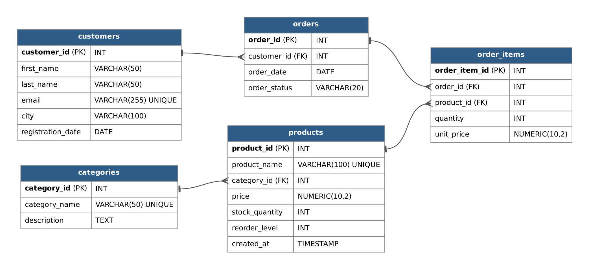

# NexaStore: Sales & Inventory Database

A PostgreSQL database for a fictional tech retailer, **NexaStore**. It manages products, customers, orders and stock, and answers real business questions with SQL: what sells best, who the best customers are, how revenue develops month by month, and what needs restocking.

This is a database project only. There is no frontend: the focus is schema design, data integrity, SQL analysis and safe order handling.

---

## Business problem

NexaStore sells keyboards, mice, audio gear, monitors and accessories. It needs one reliable place to:

- keep its product catalog and stock levels up to date
- record customers and their orders
- see which products and customers drive revenue
- know which products are running low or are out of stock
- place orders without ever selling stock it doesn't have

## Main features

- **Normalized 5-table schema** with primary keys, foreign keys and constraints
- **Data integrity rules**: no negative prices or stock, no duplicate emails, only valid order statuses, no orders for customers or products that don't exist
- **Realistic, reproducible sample data**: 25 products, 30 customers, 60 orders and 134 order items over six months (June to November 2026)
- **18 business queries** covering sales, products, customers and inventory
- **2 views**: a sales summary and a low-stock report
- **4 indexes** on the columns used most for filtering and joining
- **Transaction demo** that places an order all-or-nothing and rolls back when stock is insufficient

## Database architecture

| Table | Holds | Key relationships |
|---|---|---|
| `categories` | product categories | one category has many products |
| `products` | catalog, price, stock, reorder level | belongs to one category |
| `customers` | customer details | one customer has many orders |
| `orders` | one row per order: date and status | belongs to one customer |
| `order_items` | one row per product in an order | belongs to one order and one product |

`order_items` is the bridge between `orders` and `products`: one order contains many products, and one product appears in many orders. It also stores `unit_price`, the price **at the time of purchase**, so past orders stay correct when a product's price changes later. (In the sample data, the 27-inch Gaming Monitor rose from 279.99 to 299.99 in September, and older orders still show the old price.)

**Completed sales** are orders with status `Shipped` or `Delivered`. Pending and Processing orders can still be cancelled, and cancelled orders never count, so only completed sales are counted as revenue.

## ER diagram



## Technologies

- PostgreSQL 18
- pgAdmin 4
- SQL (DDL, DML, joins, aggregation, CTEs, views, indexes, transactions)
- Git and GitHub

## Project structure

```text
sales-inventory-database/
├── README.md
├── database/
│   ├── 01_create_tables.sql       # tables, keys and constraints (drops old tables first)
│   ├── 02_insert_sample_data.sql  # sample data
│   ├── 03_indexes.sql             # indexes
│   └── 04_views.sql               # sales_summary and low_stock_products views
├── queries/
│   ├── 01_general_sales.sql       # Q1-Q5
│   ├── 02_product_analysis.sql    # Q6-Q10
│   ├── 03_customer_analysis.sql   # Q11-Q14
│   └── 04_inventory_analysis.sql  # Q15-Q18
├── transactions/
│   └── 01_place_order.sql         # successful and failed order demo
└── docs/
    └── er_diagram.png
```

## Setup

1. Install [PostgreSQL](https://www.postgresql.org/download/) (pgAdmin is included in the installer).
2. Clone this repository:
   ```bash
   git clone https://github.com/mxespl/sales-inventory-database.git
   cd sales-inventory-database
   ```
3. Create the database:
   ```sql
   CREATE DATABASE nexastore;
   ```

## Running the SQL scripts

Run the four database scripts **in order**. `01` drops and recreates all tables, so running the scripts again always gives a clean, identical database.

**With psql:**
```bash
psql -U postgres -d nexastore -f database/01_create_tables.sql
psql -U postgres -d nexastore -f database/02_insert_sample_data.sql
psql -U postgres -d nexastore -f database/03_indexes.sql
psql -U postgres -d nexastore -f database/04_views.sql
```

**With pgAdmin:** open a Query Tool on `nexastore`, then paste and run each file in the same order.

After that, run any query from the `queries/` folder, or try the transaction demo in `transactions/01_place_order.sql`. The demo adds an order and changes stock, so re-run the database scripts afterwards to reset the data.

## Example queries

**Monthly revenue from completed sales (Q4)**
```sql
SELECT TO_CHAR(o.order_date, 'YYYY-MM') AS month,
       SUM(oi.quantity * oi.unit_price) AS total_revenue
FROM order_items oi
JOIN orders o ON oi.order_id = o.order_id
WHERE o.order_status IN ('Shipped', 'Delivered')
GROUP BY month
ORDER BY month;
```

**Average order value with a CTE (Q3)**
```sql
WITH order_totals AS (
    SELECT oi.order_id,
           SUM(oi.quantity * oi.unit_price) AS order_total
    FROM order_items oi
    JOIN orders o ON oi.order_id = o.order_id
    WHERE o.order_status IN ('Shipped', 'Delivered')
    GROUP BY oi.order_id
)
SELECT ROUND(AVG(order_total), 2) AS avg_order_value
FROM order_totals;
```

**Products that have never been ordered (Q9)**
```sql
SELECT p.product_name
FROM products p
LEFT JOIN order_items oi ON p.product_id = oi.product_id
WHERE oi.order_item_id IS NULL;
```

**Placing an order safely (transaction demo)**
```sql
BEGIN;
INSERT INTO orders (customer_id, order_status) VALUES (28, 'Pending');
-- ...add order items...
UPDATE products SET stock_quantity = stock_quantity - 2 WHERE product_id = 13;
-- Stock would drop below 0, so the CHECK constraint rejects the update
ROLLBACK;  -- the order and every item in it are undone
```

## Example results

**Key numbers (completed sales)**

| Metric | Value |
|---|---|
| Total revenue | 8,118.64 |
| Completed orders | 46 of 60 |
| Average order value | 176.49 |
| Inventory value in stock | 43,720.47 |

**Monthly revenue**

| Month | Revenue |
|---|---|
| 2026-06 | 1,004.80 |
| 2026-07 | 1,009.83 |
| 2026-08 | 1,639.73 |
| 2026-09 | 1,444.71 |
| 2026-10 | 1,979.71 |
| 2026-11 | 1,039.86 |

November has the most orders (14) but low revenue so far, because most of its orders are still Pending or Processing.

**Top 5 products: by units vs by revenue**

| By units sold | Units | By revenue | Revenue |
|---|---|---|---|
| Nexa USB-C Cable 2m | 24 | Nexa 27-inch Gaming Monitor | 1,759.94 |
| Nexa Office Keyboard | 13 | Nexa K1 Mechanical Keyboard | 939.89 |
| Nexa Swift Gaming Mouse | 13 | Nexa Swift Gaming Mouse | 649.87 |
| Nexa XL Mousepad | 11 | Nexa 24-inch Office Monitor | 599.96 |
| Nexa K1 Mechanical Keyboard | 11 | Nexa Pulse Gaming Headset | 559.93 |

The cheapest product sells the most units, but the monitors earn the most money.

**Insights**
- **Most orders ≠ most valuable:** Lukas Schmidt placed the most orders (6), but Jonas Weber spent the most (1,359.86 from 4 orders).
- **Restocking needed:** 7 products are below their reorder level, and 3 of them are out of stock.
- **Dead stock:** 4 products have never been ordered, including the most expensive monitor.

## What I learned

- How to organize a working database that could be used day to day, especially by a business.
- How to understand data much better, and how the pieces connect to each other.